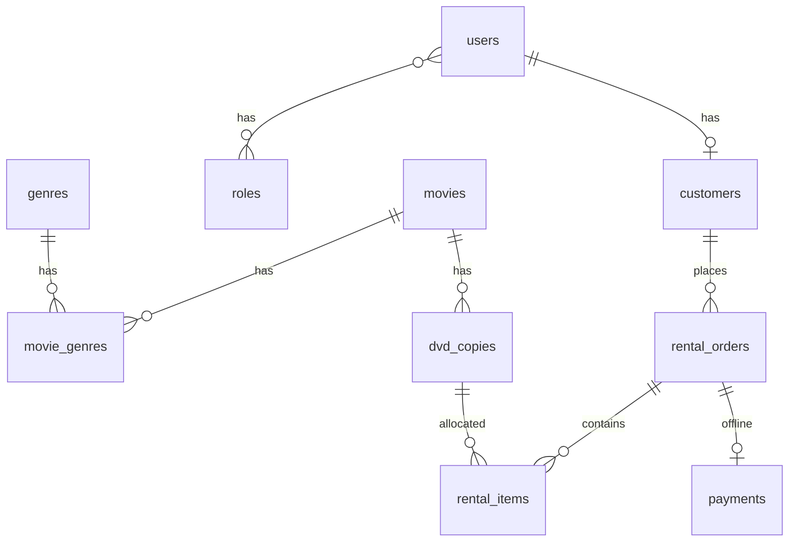

# Database

MySQL 8.4 with Flyway migrations. Hibernate `ddl-auto=validate` — schema changes go through Flyway only.

## ER overview

## Important tables

- **movies** — title catalog; `daily_rate` DECIMAL(10,2); `rental_days_default`.
- **dvd_copies** — one physical disc; unique `barcode`; `status` enum string.
- **rental_orders** / **rental_items** — order header + lines; `line_amount` and `overdue_amount` frozen historically.
- **payments** — optional offline cash/card record stub.
- **audit_logs** — minimal audit table for future use.

## Indexes

- `movies(title)`, `dvd_copies(movie_id, status)`, `dvd_copies(barcode)` unique
- `rental_orders(customer_id)`, `rental_items(due_date)`, `rental_items(status)`

## Migration

`backend/src/main/resources/db/migration/V1__init_schema.sql` creates schema and seeds role rows (`CUSTOMER`, `STAFF`, `ADMIN`).
